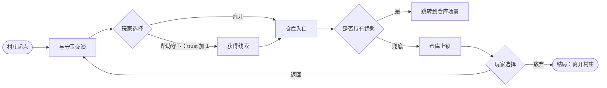

# 游戏剧情编辑器设计文档

版本：v0.1 · 日期：2026-10-11 · 状态：开发前设计基线，尚未实现或验证

## 1. 文档定位与依据

本产品服务于一个 2–5 人的游戏开发团队，用可视化方式编写、组织、调整和检查游戏剧情，并支持远程同步协作。核心交付是可用的剧情工作台，而不是完整复制 Arcweave。

本文作为后续界面、数据结构、同步机制和验收工作的共同依据。所有功能默认遵循本文；改动范围、运行规则或数据格式时，必须先记录设计变更。本文中的建议并不代表用户已经确认，也不代表产品已经实现。

### 1.1 信息可信度

| 类别 | 含义 | 本文使用方式 |
|---|---|---|
| 用户要求 | 用户明确提出的目标 | 游戏剧情可视化、方便设计调整、参考 Arcweave、支持 2–5 人远程同步协作、先形成设计文档 |
| 已核实参考 | 官方公开页面明确描述的功能 | 仅在本节引用，不推测其内部实现 |
| 本方案决策 | 为本项目提出的产品与技术方案 | 第 2–13 节均属此类，可根据实际需求修订 |
| 待确认假设 | 当前缺少的信息及默认处理 | 见第 14 节；不能在开发时悄悄当成新增需求 |

核实方式：阅读 Arcweave 官网和官方文档；没有登录其编辑器实操，也没有核实收费套餐、内部架构、性能或冲突解决算法。参考资料读取日期为 2026-10-11。

### 1.2 Arcweave 参考与本项目取舍

| 官方已描述的设计思路 | 资料 | 本项目的采用方式 |
|---|---|---|
| 节点式剧情编辑、可复用的角色/地点/物品资料、试跑与导出 | [S1] | 形成“结构编辑—内容编写—试跑检查—导出”的工作闭环 |
| 中央画布、左侧项目资料、顶部项目操作、画布导航工具 | [S2] | 采用画布主导的布局，另设右侧属性编辑面板；不是照搬界面 |
| 一个项目可有多个画布，画布按文件夹组织 | [S3] | 用章节目录组织场景画布，控制单张图的复杂度 |
| 项目实时共创，并有便笺、评论和成员访问控制 | [S4] | 保留在线状态、同步编辑、节点评论；权限收敛为三种角色 |
| 条件分支可按顺序求值，选择首个满足的分支 | [S5] | 明确区分玩家选择与自动条件判断，后者采用首个命中规则 |
| 试跑调试能追踪变量，并回退选择恢复状态 | [S6] | 提供变量面板、路径记录和状态快照回退 |

以上仅说明借鉴来源。本方案的节点类型、导出格式、锁机制及技术选型均为自主设计，不宣称与 Arcweave 兼容。

## 2. 产品目标与首版边界

### 2.1 必须解决的问题

1. 看清主线、支线、分支与汇合，能从全局定位到具体对话。
2. 调整剧情关系时不必反复修改长文档；内容与连线一起维护。
3. 角色、地点、物品的资料集中管理，引用保持一致。
4. 在接入游戏之前试跑剧情，检查选择、条件和变量变化。
5. 2–5 人可以同时工作，看到已提交的改动，避免相互覆盖。
6. 剧情能保存、恢复和结构化导出，作为游戏开发的输入。

### 2.2 首版功能分级

| 级别 | 范围 | 判定 |
|---|---|---|
| P0：首版必需 | 项目、章节目录、场景画布、节点连线、角色资料、变量与条件、试跑、全文搜索 | 完成主要创作闭环 |
| P0：协作与数据 | 登录邀请、三种权限、在线状态、不同节点同步编辑、节点占用、自动保存、本地草稿、操作历史、手动快照与恢复 | 完成远程协作且数据可追溯 |
| P0：交付 | 结构检查、JSON 导出与同格式导入新项目、基础示例项目 | 能检查并移交剧情 |
| P1：首版之后 | 节点评论、便笺、地点/物品资料、引用反查、选中区域布局整理、对话 CSV 导出 | 根据实际使用补充效率功能 |
| P2：后续评估 | 同一段文本多人共同输入、富文本、多语言、引擎适配、子流程调用 | 有真实需求后再投入 |

首版不包含 AI 自动写剧情、视频音频制作、公开发布平台、企业组织层级、复杂审批、完整任务管理、游戏引擎编辑器插件、离线多人编辑。只有账号与项目成员管理，不建设独立的企业工作空间系统。

这里的同步协作指：多人同时编辑不同对象，已保存的变化实时分发；同一节点同一时间由一个编辑会话占用。不承诺首版实现 Google Docs 式的同段文本共同输入。

## 3. 用户与主要流程

| 角色 | 主要行为 |
|---|---|
| 剧情设计者 | 搭建主线、分支、结局，编写对话，调整节奏 |
| 共同作者/策划 | 编辑其他场景，补充角色与条件，试跑并检查问题 |
| 程序或审阅成员 | 查看流程、测试路径、获取导出，必要时提出修改意见 |

### 3.1 从空项目到可交付剧情

1. 所有者创建项目，邀请成员，建立章节目录及第一个场景。
2. 在画布上建立起点、剧情段落、选择和结局，连接成主线。
3. 在右侧面板填写对白、选择文案、角色引用和变量修改。
4. 添加条件判断、支线及跨场景跳转。
5. 执行检查，点击问题定位到节点或连线。
6. 从项目入口试跑，再从局部节点测试指定变量组合。
7. 创建命名快照，导出经过检查的 JSON。

### 3.2 调整与协作示例

作者甲调整“村庄入口”的对话，作者乙同时搭建“废弃仓库”的分支。两人可以浏览对方画布及已保存内容。乙选中甲正在编辑的节点时，可以阅读但不能修改；界面显示占用者，支持请求对方释放的产品入口，首版可通过团队既有沟通工具协调。

本产品不自动改变其他人的视角。每个人的缩放、选中对象、当前画布和试跑进度都是个人状态。

## 4. 信息结构与界面

### 4.1 层级

```text
项目
├─ 章节目录（组织信息，不执行剧情）
│  ├─ 场景画布
│  │  ├─ 剧情节点与连线
│  │  └─ 便笺（P1，不执行剧情）
│  └─ 场景画布
├─ 角色资料（P0）/地点与物品（P1）
├─ 项目变量
├─ 成员与权限
└─ 历史与快照
```

目录用于分类，画布用于容纳节点；目录顺序、节点坐标、颜色不决定剧情执行顺序。项目设一个正式入口，各场景设一个起点；场景起点可以没有来自其他场景的引用。

### 4.2 工作台布局草图

```text
┌ 项目名 / 当前场景 ─ 保存状态 ─ 在线成员 ─ 检查 ─ 试跑 ─ 导出 ┐
│ 章节与场景目录 │                                      │ 属性面板 │
│               │            剧情画布                  │ 标题     │
│ 角色资料      │       节点 → 选择 → 分支 → 结局       │ 台词     │
│ 项目变量      │                                      │ 角色引用 │
│ 搜索结果      │                                      │ 条件/效果│
│               │                    缩略图 / 缩放工具 │ 编辑占用 │
├───────────────┴──────────────────────────────────────┴──────────┤
│ 可展开底部面板：检查问题 / 试跑路径 / 操作历史                    │
└────────────────────────────────────────────────────────────────┘
```

左栏约 240px、右栏约 360px，可折叠或调整宽度，画布占剩余区域。这些尺寸是初稿，应在 1440×900 和 1920×1080 的桌面窗口中验证。首版优先桌面浏览器，窄屏提供基本查看，不承诺手机创作体验。

### 4.3 视觉与可读性

- 中文界面，首版使用浅色中性背景、轻网格、克制的阴影和强调色。
- 节点显示类型图标、标题、最多三行摘要、编辑状态；全文在属性面板编写。
- 节点类型同时用图标、文字和颜色区分；错误不只靠红色表达。
- 连线箭头表达方向，分支出口显示选择文案或条件摘要，选中时提高对比度。
- 缩远时隐藏正文，保留标题与结构；筛选时淡化无关节点，保留结构上下文。
- 草稿/待审阅/已确认仅是内容状态，不代表发布，也不跳过试跑节点。
- 属性面板分为“内容”“逻辑”“资料”页签，普通对白编辑不需要看到脚本代码。

### 4.4 画布操作规范

| 操作 | 行为 |
|---|---|
| 单击节点 | 选中并显示属性；仅阅读不抢占编辑权 |
| 双击或点击“编辑” | 申请节点占用，成功后可输入 |
| 空白处右键 / 新建按钮 | 在指定位置创建节点 |
| 从出口拖拽到入口 | 创建连线；非法连接即时说明原因 |
| 空格拖动 / 中键拖动 | 平移画布 |
| 滚轮 | 缩放；提供触控板模式设置以避免误操作 |
| 框选 / Shift 多选 | 多选；可批量移动或删除，事务全部成功或全部拒绝 |
| Ctrl+D | 复制选中子图，生成新 ID；仅复制内部连线，外部引用列出提醒 |
| Delete | 展示受影响连线/跳转数量，确认后原子删除 |
| Ctrl+Z / Ctrl+Shift+Z | 撤销/重做自己的操作，受协作冲突检查约束 |
| F / 适应画布 | 将选中内容或整个场景移入视野 |

文本输入区域内不触发画布删除、复制和撤销快捷键；中文输入法合成期间不得误提交半成品文字。自动布局属于 P1，只调整选区坐标，先预览，可撤销，不改连线语义。

## 5. 剧情图与运行规则

### 5.1 节点类型

| 类型 | 内容 | 出口规则 | 运行方式 |
|---|---|---|---|
| 起点 Start | 场景名称及入口说明 | 一个普通出口 | 自动进入下一节点；每个画布恰有一个 |
| 剧情 Story | 标题、叙述及有序对白行 | 一个普通出口 | 按顺序展示，点击继续；进入时执行节点效果 |
| 选择 Choice | 提问文本、有序选项 | 每个选项对应一个出口 | 展示可用选项，玩家选中后执行选项效果并跳转 |
| 条件 Condition | 有序条件和兜底项 | 每个条件及兜底各一个出口 | 自动选择首个满足条件；无命中走兜底 |
| 跳转 Jump | 目标画布与节点 ID | 无普通出口 | 自动进入目标节点；默认选择目标场景起点 |
| 结局 End | 结局名称、正文、结局标识 | 无出口 | 展示正文并结束本次试跑 |

Story 的对白行为 `{id, speakerId或空, text}`，允许多位角色在一个段落中依次发言；空 speakerId 表示旁白。首版采用纯文本。角色显示名改变不会改变引用 ID。

节点可以暂时缺少出口以便搭建草稿；保存草稿不要求剧情完整，正式导出与完整试跑必须通过相应检查。

### 5.2 连线、选项与跨场景规则

- 普通连线仅在同一画布内建立；跨场景统一使用 Jump，避免跨画布长线。
- 连线绑定稳定的出口 ID，不绑定出口显示位置；排序和改文案不会改变连接目标。
- 一个出口最多一条连线；目标节点可以有多个入边。多个路径汇入不会触发并行执行。
- 选择的条件独立求值，可能同时有多个可用选项；自动条件节点只走一个出口。
- Choice 默认隐藏不满足条件的选项；若所有选项不可用，停止并报告死路。编辑时警告没有无条件选项，但不武断认定一定不可达。
- Condition 必须有一个最后的兜底项；修改顺序会改变优先级，界面明确提示。
- 允许循环、返回前文、跨场景循环；不允许普通边指向 Start。Jump 可以指向 Start，且不会重置项目变量。
- P0 的 Jump 是单向跳转，无调用栈、参数和返回值。复用同一剧情后返回不同位置属于 P2 子流程能力。
- 编辑时删除存在入边、跳转引用的对象，需要展示影响；禁止悄悄删除别人的已连接内容。

### 5.3 变量与表达式

变量仅有项目作用域，包含稳定 ID、唯一 key、显示名、类型和默认值。类型支持布尔、有限数值、字符串；key 用于导出与阅读，所有内部引用使用 ID。首版无数组、对象和自定义函数。

条件用表单构建：变量 + 比较操作 + 同类型常量，支持 AND/OR 分组。布尔支持等于/不等于，数值增加大小比较，字符串支持等于/不等于。保存为受限表达式树，不执行 JavaScript 或任意用户代码。

效果支持设值，以及数值增加/减少；效果列表依次执行。类型错误、非有限数值或引用缺失时报错，整组效果回滚，禁止执行一半。字段为空不等于 false、0 或空字符串。

删除被引用变量前要求解除引用；重命名 key 不破坏 ID 引用。角色资料、变量定义修改也使用对象占用和版本检查。

### 5.4 一次试跑的执行语义

1. 取得已保存的项目快照及 revision，初始化变量默认值；局部测试可覆盖初始值。
2. 进入 Story 时原子执行其效果，再显示叙述与对白；重复进入会再次执行效果。
3. 到达 Choice 时基于当前变量计算可用选项；点击选项后再次核验条件，原子执行选项效果，再进入目标。
4. Condition 无副作用，按顺序判断；Jump 无副作用，直接转移。
5. 自动节点连续执行达到 100 步时暂停并展示路径，防止浏览器被循环卡住；此阈值是保护措施，不能据此认定故事非法。
6. 点击“退回上一步”恢复之前的节点、变量和已展示内容快照，不重新执行效果；手动修改调试变量会清除后续回放分支。
7. 试跑状态独立于创作数据，变量调试不修改默认值。协作者改稿不影响正在进行的试跑；提示有新版本，用户重启后才加载。

首版同一人在多个标签页的试跑彼此独立；多人不会共享“玩家存档”。

### 5.5 贯穿示例：进入仓库

项目变量：`hasKey=false`、`trust=0`。村庄对话之后，玩家选择帮助守卫或直接离开；帮助后 `trust += 1`。仓库入口自动判断 `hasKey == true`，满足则进入仓库，否则提示上锁并提供返回村庄的选择。



“获得线索”不自动意味着取得钥匙；若没有设置 `hasKey=true` 的行为，持钥匙路线可能在默认流程中不可用。这正是试跑和变量检查应暴露的问题，工具不得替作者补写因果。

## 6. 资料、搜索与检查

角色资料包含 ID、名称、简介和标签，节点通过 ID 引用。删除被引用角色默认拒绝；可显式选择将相关对白改为旁白后删除，作为一个事务执行。地点、物品及头像上传属于 P1，不让素材管理阻塞首版。

全文搜索覆盖节点标题、叙述、对白和选项文案，结果显示章节/场景/节点定位；过滤支持节点类型、角色和内容状态。搜索不改变故事结构，点击结果切换画布并定位。

P1 评论锚定节点，支持回复、解决/重开，保留作者和时间；删节点后评论进入历史而非失去上下文。不包含聊天、邮件通知及自动外部消息。

### 6.1 检查规则

| 等级 | 规则举例 | 行为 |
|---|---|---|
| 错误 | 正式入口缺失、端口未连接、出口重复连接、跳转失效、变量类型错误、资料引用失效、条件缺兜底 | 阻止正式运行数据导出；草稿仍可保存 |
| 警告 | 从正式入口按图结构无法到达、缺少无条件选择、没有结构路径到结局、空正文、存在循环 | 可导出，需显式知晓警告 |
| 提示 | 长段落、场景过大、布局过密 | 供作者改善，不自动重写 |

静态可达性忽略条件真假，只能判断图结构。首版不能证明全部变量组合都能到达结局，也不能自动证明人物行为合理或剧情没有矛盾。“没有结构路径到结局”按反向可达性检查，而不是枚举所有路径。

检查结果包含 ruleId、等级、节点/边 ID 和可操作说明，点击定位；正式导出在服务器对同一快照重新检查，不能只信任前端结果。

## 7. 2–5 人远程同步协作

### 7.1 协作方案选择

采用中心服务器排序操作、数据库事务持久化、WebSocket 分发增量变化、短期对象占用。适合小团队，方便实现图结构约束、权限检查和可追溯历史。

暂不采用全量项目最后写入覆盖，也不在首版引入全文 CRDT。此决策控制同对象冲突，代价是同一节点不能两人一起输入；若实际工作频繁需要共同写一段文字，再增加文本 CRDT，但图结构仍需明确一致性规则。

### 7.2 在线与编辑占用

- 在线信息包含成员、当前画布及选中节点；鼠标指针仅在同画布展示，可关闭。
- 节点内容、坐标和自身出口定义共用一个占用；连线和资料各自有独立版本。创建/删除边会一并校验受影响节点是否被其他会话占用。
- 申请占用后服务端签发会话绑定 token 和递增 fencingToken；建议每 10 秒续租、30 秒过期。具体参数需联调验证。
- 编辑结束、切换节点或关闭面板时，先保存再释放；服务端只接受最新租约持有者的写入。
- 租约绑定编辑会话，不仅绑定用户；同一用户第二个标签页不能同时写入。
- 断线后马上停止新共享编辑，保留当前输入为本地草稿；旧租约过期后可能被他人取得。
- 首版不提供静默强抢。所有者可解除异常占用，服务端使旧 token 失效，旧持有者草稿保留并提示。
- 多选移动、删除和布局操作检查全部受影响对象，发现占用则整体拒绝，不部分成功。

### 7.3 提交、确认与一致性

每次操作携带 operationId、会话 ID、projectEpoch、相关对象 expectedVersion，以及需要的占用 token。结构操作携带全部读写对象的版本，不能只检查起始节点。

```text
客户端提交操作
  → 服务端验证身份、成员权限、epoch、租约、对象版本及图约束
  → 数据库事务写业务数据、操作日志和待发送事件，分配 projectRevision
  → 事务提交后回复确认，并向项目成员广播
  → 客户端按 revision 应用；检测缺口后补拉增量或重载快照
```

- 自动保存建议在输入停顿 800ms 后提交；持续输入时最长每 3 秒提交一次。只有持久化确认后显示“已保存”。
- 提交分为保存中、已保存、断线、保存失败，失败提供重试和复制草稿。
- operationId 用于幂等：同一账号/操作 ID 重发不重复生效；内容不一致的复用请求被拒绝。
- 数据库是持久化事实来源，WebSocket 只是传输；服务器重启后也能重新获取一致状态。
- 不同对象的操作不因全项目旧 revision 一概拒绝，冲突判断基于相关对象版本；revision 用于事件排序。
- 移动时可广播临时拖拽位置，松手后才持久化最终坐标；临时信息不算保存，不进入历史。
- 权限检查覆盖读取、订阅、写入、导出和附件；角色变更或移除成员使已有会话权限立即失效。

### 7.4 断线、恢复和冲突

已确认内容从服务端恢复；未确认文本存入 IndexedDB，按账号/项目/节点区分，保存 baseVersion 和草稿。无法使用本地存储时显示明确提示，并提供复制/下载草稿。首版不允许断网时继续改图，也不宣称草稿能抵御清理浏览器数据。

重连后先读取最新状态并重新申请占用：若版本未变且 epoch 相同，可重试原操作；若已变化，显示“原稿/当前稿/我的草稿”，让作者选择或手动合并。不能直接用本地草稿覆盖远端。

节点已删除、权限已撤销或项目已恢复快照时，不自动提交草稿；仍允许用户复制自己的输入。对未确认的结构操作先查询 operationId 的执行结果，不能盲目重放。事件保留窗口之外的客户端重新拉取快照。

### 7.5 权限

| 权限 | 所有者 | 编辑者 | 查看者 |
|---|---|---|---|
| 查看与试跑 | 是 | 是 | 是 |
| 编辑剧情/资料/变量 | 是 | 是 | 否 |
| 创建快照、导出 | 是 | 是 | 否 |
| 评论（P1） | 是 | 是 | 是 |
| 邀请、移除、修改角色 | 是 | 否 | 否 |
| 恢复项目、删除项目 | 是 | 否 | 否 |

默认每项目最多 5 名成员（含所有者），验收也覆盖 5 名同时在线；同成员多标签页不计新成员，但需限制连接频率。邀请使用到期且一次性的链接，接收者必须登录，无匿名编辑。只有一个所有者，转移后不能出现无所有者项目。删除项目进入可恢复回收站，默认 30 天后清理。

## 8. 历史、撤销与恢复

操作日志记录操作者、服务端时间、操作类型、对象、前后变化和 revision；文本自动保存的连续改动可在展示层聚合，但持久化记录保持完整。

撤销是新的反向操作，只针对自己的动作。服务器验证受影响对象仍处于该动作的结果版本；若已被他人修改，则拒绝撤销并说明原因。批量动作整体撤销。重做同样验证版本，不允许用撤销覆盖别人后续工作。

快照是某个 revision 的完整创作数据，可命名为“第一章评审前”。恢复流程：所有者查看差异与影响 → 系统先备份当前项目 → 获取短时项目维护锁 → 原子恢复 → 增加 projectEpoch 并写新 revision → 使旧租约和旧编辑请求失效 → 全员重载。旧草稿保留但只能手动对照。

恢复快照不恢复旧成员列表、邀请或权限，不降低当前安全设置；恢复剧情数据也不删除审计记录。阶段交付前创建命名快照，系统每天创建一次自动快照，默认保留最近 30 天；自动快照不是独立备份。

## 9. 数据模型与导出契约

### 9.1 核心实体

| 实体 | 核心字段与关系 |
|---|---|
| Project | id、name、entryNodeId、revision、epoch、schemaVersion |
| Membership / Invite | projectId、userId、role / tokenHash、expiresAt、usedAt |
| Folder / Board | id、projectId、parentFolderId、name、sortOrder / startNodeId |
| Node | id、boardId、type、title、payload、contentStatus、version |
| NodeLayout | nodeId、x、y、width、height；属于编辑数据，不决定执行 |
| Port | id、nodeId、kind、sortOrder；Choice/Condition 与其条目稳定绑定 |
| Edge | id、boardId、sourceNodeId、sourcePortId、targetNodeId、version |
| Character | id、projectId、name、description、tags、version |
| Variable | id、projectId、key、name、type、defaultValue、version |
| Operation / Snapshot | operationId、revision、actor、patch / snapshot 数据及描述 |
| EditLease | entityId、sessionId、token、fencingToken、expiresAt |

实体使用稳定 UUID；客户端新建对象可预生成 ID，服务端保证项目隔离及唯一性。Story/Choice/Condition 的 payload 按类型校验，不允许把无约束 JSON 当作完整数据规范。运行状态 RunSession 留在客户端，和上述创作实体分离。

边与端口有引用约束；删除节点及相关边同事务完成。删除画布前扫描跨画布 Jump 引用；存在引用时拒绝，要求先处理。资料和变量删除参照第 5–6 节。

### 9.2 导出类型

- **创作备份 JSON**：包含目录、完整图、坐标、资料、变量与内容状态；允许有草稿错误，附带检查结果。不包含账号、邀请、会话 token、编辑租约或个人草稿。
- **运行 JSON**：包含正式入口、节点/端口/边、角色与变量定义，去除坐标、便笺、评论和协作信息；阻止已知错误，保留稳定 ID。
- 两种文件都有 format、schemaVersion、projectRevision 和导出时间；明确区分，防止把备份当运行包。
- 运行格式是本项目自定义契约，不是 Arcweave JSON、Ink 或 Yarn 格式。首版不承诺直接导入 Unity/Unreal/Godot。

示意外层结构（字段名建议，完整 schema 在实现阶段另行固化）：

```json
{
  "format": "story-editor-runtime",
  "schemaVersion": 1,
  "projectId": "UUID",
  "projectRevision": 42,
  "exportedAt": "ISO-8601",
  "entryNodeId": "UUID",
  "boards": [],
  "nodes": [],
  "edges": [],
  "characters": [],
  "variables": []
}
```

服务器从一致性快照导出，不能把编辑中不同 revision 的对象拼在一起。输出顺序固定，运行逻辑与编辑器试跑共用受限解释器，未来引擎适配以语义测试样例为准。

创作备份导入只支持新项目：先校验格式、版本、大小、类型与引用，展示摘要，再原子创建；保留项目内对象 ID，生成新 projectId。未知新版本拒绝，不静默丢字段。导入不创建旧成员、不覆盖已有项目。相同备份导出—导入后，图与运行结果应一致。

## 10. 技术架构建议

以下是当前建议，未经过原型性能验证；不视为 Arcweave 使用的技术。

| 层 | 建议 | 理由 |
|---|---|---|
| 客户端 | React + TypeScript + Vite | 编辑器型应用，前后端共享类型便于维护 |
| 画布 | React Flow（@xyflow/react） | 利用节点、端口、连线及视口基础设施；先验证中文输入与大图表现 |
| 普通界面状态 | Zustand 或等价轻量方案 | 视口、选区与服务端实体分离，避免整项目反复渲染 |
| 服务端 | Node.js + TypeScript + Fastify，WebSocket | 单服务同时处理 HTTP 和同步，不引入微服务 |
| 数据库 | PostgreSQL | 持久化、事务、版本与引用约束；同步日志与业务修改可原子提交 |
| 运行核心 | 独立 TypeScript 受限解释器及校验库 | 前端试跑和服务端导出检查共享规则 |
| 部署 | 一个公网 HTTPS 域名 + 单应用实例 + 数据库 | 2–5 人首版规模，降低运维负担；WSS 复用同域 |

首版无需 Redis、消息队列、分布式锁或 Kubernetes。单实例租约可驻内存，服务重启时全部租约失效并要求客户端重新申请；业务数据与操作结果必须持久化。若以后多实例部署，再增加共享租约与广播，不能直接复制当前内存状态方案。

建议模块边界：项目与权限、剧情图命令、资料与变量、运行与检查、同步、历史与导出。HTTP 用于登录、项目读取、补拉事件、快照和导入导出；WebSocket 用于占用、编辑命令、在线状态和事件分发。所有写通道调用同一套命令校验服务。

登录首版采用管理员邀请的小团队账号与成熟认证库，避免从零实现密码学。具体登录提供商尚待确认；会话 cookie 使用 Secure/HttpOnly/SameSite，WebSocket 校验来源与身份。文本按纯文本渲染，日志不记录密码/token，成员无权通过猜 ID 读取其他项目。P1 附件引入后必须有独立的大小、类型和访问限制。

## 11. 容量、性能与运维目标

这些是验收目标而不是已测得的性能，也不限制项目最多只能写这些内容。

| 项目 | 初始目标与测量条件 |
|---|---|
| 基准数据 | 20 个画布、共 2,000 节点/3,000 连线、当前画布 300 节点；5 人同时在线 |
| 同步延迟 | 网络 RTT ≤150ms，无明显丢包时，从提交到另一客户端展示 P95 ≤500ms；不含自动保存等待时间 |
| 保存确认 | 同条件下服务端持久化确认 P95 ≤1s |
| 场景加载 | 普通桌面 Chrome/Edge、10Mbps 网络，300 节点场景可操作 P95 ≤3s |
| 画布交互 | 选定并记录的基准机器上，300 节点常用缩放/拖动目标 ≥30 FPS；记录设备与渲染比例 |
| 数据一致性 | 5 人并发、重复提交、重连及服务重启后，所有已确认操作均保留，客户端收敛到同一 revision |

按画布加载完整节点及边，项目目录加载摘要，避免打开项目就渲染全部节点。搜索使用服务器查询；在线指针限频，不进入数据库。项目规模超过基准时先实测，再确定分页、渲染裁剪和数据上限。

日常运维：记录错误、同步延迟、保存失败率和连接数；提供应用健康检查。数据库每天独立备份到不同存储位置，默认保留 30 天，交付前执行一次恢复演练。若仅有每日备份，服务器灾难恢复的数据损失窗口可能接近 24 小时；若不能接受，部署持续日志归档或托管数据库时间点恢复。服务器级备份与应用快照不能混为一谈。

## 12. 实施阶段与交付门槛

按阶段完成，不在尚无团队配置和原型数据时承诺工期。

| 阶段 | 交付 | 完成门槛 |
|---|---|---|
| A：规则与交互原型 | 主布局、示例剧情、节点 payload/端口 schema、受限表达式规范 | 示例分支、循环、跳转和效果顺序无歧义；300 节点画布原型实测 |
| B：单人创作闭环 | 存储、节点连线、对白、角色、变量、检查、试跑、JSON 往返 | 可完成并导出示例；刷新后数据保留；试跑符合规则 |
| C：远程协作 | 账号邀请、权限、同步、占用、本地草稿、冲突处理 | 两台不同网络电脑联测，再跑 5 人并发场景 |
| D：首版可靠性 | 历史撤销、快照恢复、备份部署、错误提示、基准验证 | 下表的 P0 验收通过，无已知丢稿/越权/错误导出问题 |
| E：效率增强 | 评论、便笺、资料反查、布局整理、CSV | 依据实际创作反馈排序，不反向拖延首版 |

## 13. 可执行验收清单

| 编号 | 场景 | 预期 |
|---|---|---|
| AC-01 | 创建章节、两个场景、对白、玩家选择和结局 | 能用主界面完成，不手写脚本或修改数据库 |
| AC-02 | 重排选择文案与条件优先级 | 连线仍绑定原出口；条件路径按新顺序首个命中 |
| AC-03 | 通过 Jump 跳到第二场景，再返回前场景 | 变量保持；不存在隐含返回栈 |
| AC-04 | 选择效果改变量后退回上一步 | 变量与节点恢复，不重复执行效果 |
| AC-05 | 默认没有钥匙；局部测试设为有钥匙 | 前者走上锁路线，后者进入仓库；默认值不被测试修改 |
| AC-06 | 5 人编辑不同节点或场景 | 全员收到已确认变化；各自视口不被移动 |
| AC-07 | 两个会话同时申请同一节点 | 仅一个成功，另一方可阅读并看见占用者 |
| AC-08 | 占用者断线，租约到期后他人编辑，旧会话重连 | 旧 token 无效；原草稿保留，不能覆盖新稿 |
| AC-09 | 事务已提交但回复丢失，重发相同 operationId | 修改只执行一次，返回原执行结果 |
| AC-10 | 服务提交后、广播前重启 | 已确认操作不丢；客户端补拉或重载后收敛 |
| AC-11 | 甲撤销自己的动作，而乙已改该对象 | 拒绝覆盖乙，显示冲突原因 |
| AC-12 | 删除被占用节点/含跳转目标的画布/被引用变量 | 拒绝或先显式处理依赖，不留下静默悬空引用 |
| AC-13 | 查看者发送写请求、移除成员保留旧连接 | 服务端拒绝；被移除成员不再收到新项目数据 |
| AC-14 | 有人编辑时所有者恢复快照 | 原稿先备份；epoch 更新，全员重载，旧请求不生效 |
| AC-15 | 创作备份导出后导入新项目 | 内容、坐标、引用与运行语义一致；不带入权限和 token |
| AC-16 | 缺连线、错误类型、失效 Jump、自动无限循环 | 错误定位准确；非法运行导出被拒；循环试跑暂停 |
| AC-17 | 浏览器刷新、中文输入法、服务器短暂不可用 | 已保存内容恢复；合成输入不误触快捷键；未确认文本可恢复 |
| AC-18 | 在另一台环境从独立数据库备份恢复 | 能登录、打开剧情并复核最近备份 revision |

需要真实服务和网络验证 AC-06 至 AC-14；单机两个标签页或静态演示不能替代远程协作验收。先建立运行语义、权限与并发测试，再做有代表性的界面联测。

## 14. 待确认事项与当前默认

| 待确认 | 当前设计默认 | 改变时影响 |
|---|---|---|
| 主要游戏类型 | 通用分支叙事、对白与任务剧情；无实时并行任务模拟 | 复杂任务系统可能需要事件、异步等待与状态机 |
| 使用的游戏引擎 | 首版以自定义 JSON 交付 | 确定引擎后增加适配层及运行语义一致性测试 |
| 是否要求同段文本共同输入 | 接受同节点单人占用、不同节点同时编辑 | 若要求，则调整同步架构及撤销设计 |
| 部署位置与账号方式 | 小团队公网部署，桌面浏览器使用，邀请制 | 部署地区影响网络；账号提供商影响登录与维护 |
| 实际剧情规模 | 用第 11 节基准评估，超出后再定优化 | 大图和大量长文本可能影响加载、搜索与备份 |
| 是否需要图片/语音/多语言 | 首版纯文本，素材与多语言后置 | 影响资料、存储、导出和编辑界面 |
| 可接受的灾难恢复损失窗口 | 暂按每日独立备份说明风险，不承诺零损失 | 较低损失窗口需持续备份与额外运维 |

这些事项不阻止先做交互与单人原型，但正式开发协作、登录及引擎适配前应固定相应决策。不得据此自行扩展为商业 SaaS 或复杂引擎平台。

## 15. 设计变更规则与参考资料

### 15.1 变更规则

每个新增需求标注来源和优先级；任何节点语义、权限、冲突策略或导出字段变化，都记录“原因—影响—兼容处理—验收变化”。不能只改界面而保留旧解释器规则。数据格式变化必须更新 schemaVersion 与迁移方案，未经实际验证的性能与完成情况不能写成事实。

后续原型、代码和测试如与本文冲突，应先明确修改本文或修复实现；不要让文档与产品长期存在两套规则。

### 15.2 官方参考

- [S1] [Arcweave Features](https://arcweave.com/features)：节点编辑、资料复用、试跑、协作及导出能力。
- [S2] [Arcweave interface](https://docs.arcweave.com/introduction/quick-tour/ui)：画布、左侧栏、顶部与底部菜单、视口操作。
- [S3] [Boards](https://docs.arcweave.com/project-items/boards)：多画布与文件夹组织。
- [S4] [Collaboration](https://docs.arcweave.com/introduction/quick-tour/collaboration)：实时共创、访问控制、便笺及评论。
- [S5] [Branches](https://docs.arcweave.com/project-items/branches)：有序条件、首个命中与兜底路径。
- [S6] [Debugger](https://docs.arcweave.com/project-tools/play-mode/debugger)：变量追踪与选择回退。
- [S7] [Arcweave 官网](https://arcweave.com/)：产品定位及整体创作流程。

本项目仅参考通用交互和工作流程，自行定义界面、数据格式与实现；未复制其品牌、素材或私有实现。
